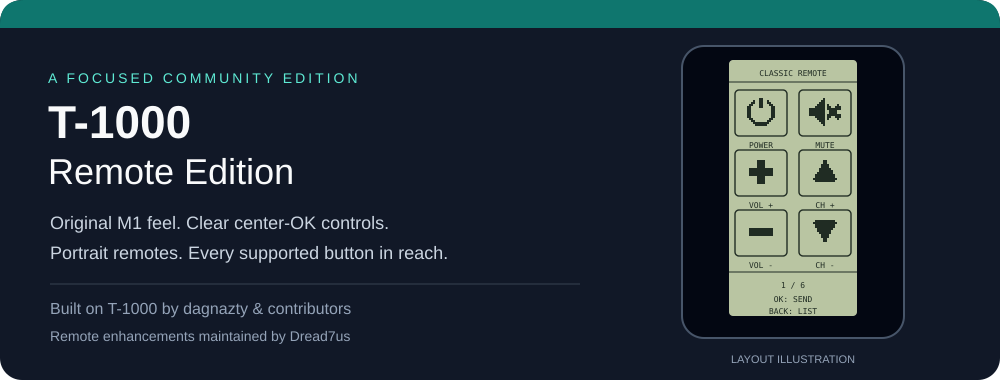
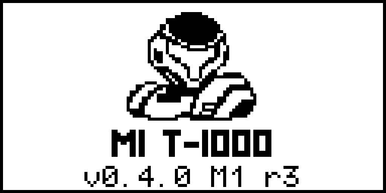
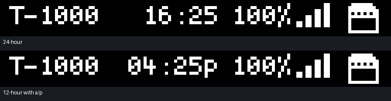
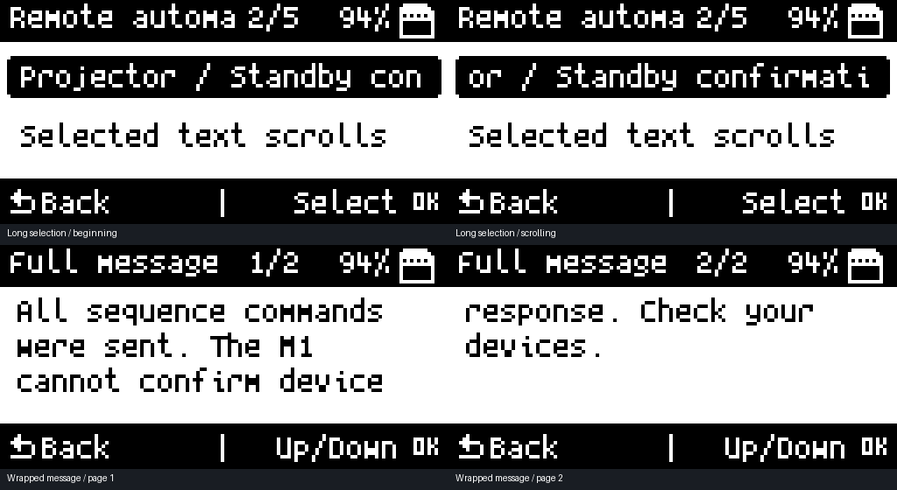
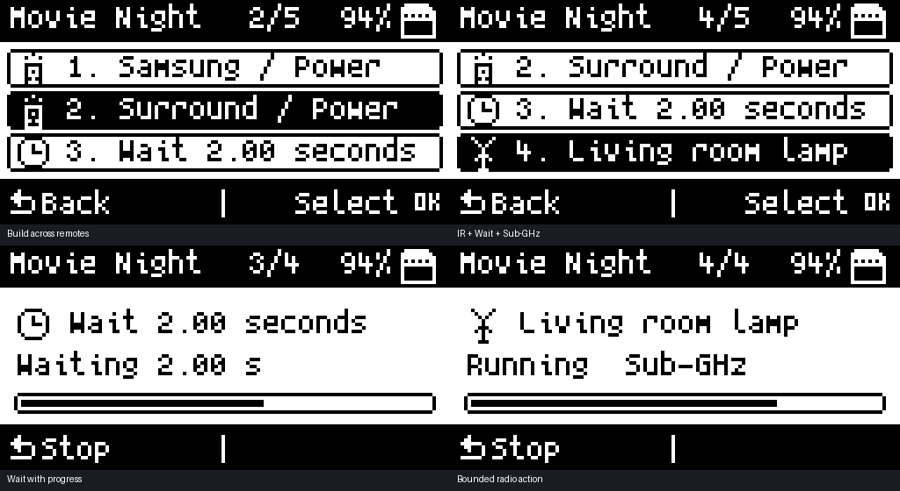
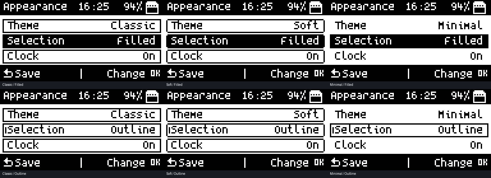

<div align="center">

# T-1000 Remote Edition

### Classic M1 controls. Built on the work of T-1000.

[](https://github.com/dagnazty/M1_T-1000)
[](https://www.monstatek.com/)
[](#build-and-check)
[](LICENSE)
[](https://github.com/Dread7us)

A focused set of **remote-control and interface improvements** for the MonstaTek M1.

**The firmware foundation is [T-1000 by dagnazty and its contributors](https://github.com/dagnazty/M1_T-1000).**
This fork documents our additions; credit for the broader firmware belongs upstream.



<sub>Layout illustration, not a device photograph or captured framebuffer.</sub>

[Splash screen](#splash-screen) · [Our changes](#what-this-edition-changes) · [Controls](#controls) · [Validation](#validation-status) · [Update upstream](#keeping-up-with-t-1000) · [Original README](README.upstream.md)

</div>

---

## Splash screen

<div align="center">

### Updated splash screen



**Revision 3 · Confirmed on the physical M1**

<sub>Enlarged preview rendered from the actual firmware code and fonts—not a device photograph.</sub>

A refreshed splash screen featuring the new **monochrome avatar emblem** and **M1 T-1000** branding.

[Artwork, native-size asset, and layout details](documentation/remote-edition/avatar-splash.md)

</div>

---

## Infrared output and selection styling

**Revision 13.** Parsed and raw signals share a frame start that primes timing before enabling the carrier and baseband. Replay reports a carrier or encoder failure instead of treating it as a completed send. Parsed timing storage is fixed, and Denon continuation frames contain only the entries they write. **System → Appearance → Selection** adds **Underline**. [Infrared changes and validation](documentation/remote-edition/ir-services.md).

## Infrared timing and switching

**Revision 12 · Built and native-tested; device check pending.** Universal power playback now waits for complete protocols rather than a fixed sleep. IR inter-frame gaps use clock deadlines without blocking the shared timer service. Receiver entry/exit resets stale timer and interrupt state, and the diagnostic transmitter no longer frees static timing storage. [Corrections and test coverage](documentation/remote-edition/ir-services.md).

## Saved settings and a cleaner System menu

**Revision 11:** backlight changes save immediately and stay consistent on the splash/home screen and after restarting. **System → Date & Time** offers an explicit **OK Save**, unsaved-change choices, and a **Time saved** confirmation. The nested settings panel is now **Device options**; the separate text-history viewer has been removed. [Brightness persistence and validation](documentation/remote-edition/backlight.md).

## Clock consistency

**Revision 10 · Clock agreement confirmed on the M1 after saving:** Set Time and the home screen use the same local time, with consistent 12-hour AM/PM display. RTC failures are checked, and Wi-Fi sync preserves the configured UTC offset. [One-time setup after updating and validation](documentation/remote-edition/clock.md).

## Readable text and IR recovery

**Revision 9:** the home header shows the full **T-1000** name, with balanced clock/battery/status spacing in both time formats. Confirmed on the physical M1.





**Revision 8 · Built and native-tested; physical verification pending.** Long selections scroll, common messages wrap into pages. IR updates address PWM initialization, timer recovery, final-sample bounds, complete protocol frames, and Denon/Kaseikyo field conversion.

[Reading controls, coverage, and IR validation](documentation/remote-edition/text-and-ir.md)

## Remote automations

**One sequence. Multiple remotes.** Build named chains under **Infrared → Automations**: select individual IR buttons, insert waits, and include native M1 Sub-GHz recordings.



Reorder, rename, replace, duplicate, or delete actions and chains. Repeat a button as many times as needed within the step limit; **Duplicate action** creates an independent copy. Back stops execution. Source checks and fail-fast playback help keep saved actions predictable. **Revision 7 · Direct remote selection and repeated actions tested; physical validation pending.**

[Setup, supported formats, and validation](documentation/remote-edition/automations.md)

## Appearance



**Revision 5 · Boot and Appearance changes/saving confirmed on the M1.** Shared menus, dialogs, status panels, and saved appearance preferences form the first stage of the interface refresh. [Settings, coverage, and next stages](documentation/remote-edition/appearance.md).

## What this edition changes

| Addition | Result |
|---|---|
| **Readable text and IR recovery** | Scrolling selections, wrapped/paged messages, an application-wide overflow text viewer, and deterministic IR initialization/completion. [Coverage and validation](documentation/remote-edition/text-and-ir.md). |
| **Cross-remote automations** | Named IR/Sub-GHz/Wait sequences with an icon-based editor, reordering, duplication, progress, cancellation, and source checks. [Guide and supported formats](documentation/remote-edition/automations.md). |
| **Appearance foundation** | Three themes, filled/outlined selections, header clock and battery options, reduced animation, and shared-menu wrapping. **System → Appearance**. [Preview, coverage, and roadmap](documentation/remote-edition/appearance.md). |
| **Avatar splash screen** | A personalized monochrome avatar emblem and refreshed startup layout. [Preview and artwork details](documentation/remote-edition/avatar-splash.md). |
| **Consistent portrait remotes** | Power / Mute across the top; Volume + / Channel + below; Volume − / Channel − on the third row, independent of file order. Input takes Mute's place when available; absent controls leave vacant positions. All remaining buttons follow on later pages. |
| **Whole-remote learning** | Learn the first button, accept/edit a suggested remote title, name the button, then choose **Add next** to keep building the same remote. |
| **Skip unavailable controls** | Press **Right → Skip** to bypass controls your remote lacks. The choice is remembered per remote as an ignorable `.ir` comment, survives edits/renames, and creates no empty buttons. |
| **My Remotes manager** | Play, add buttons, edit button names, rename an entire remote, or confirm deletion. Includes older files from `IR/Learned` and custom remotes at the IR root. |
| **Honest name suggestions** | Exact, unambiguous IRDB matches suggest a remote title and button name. Other captures use an editable protocol-based title, or `Raw Remote`; protocol detection alone does not identify a brand/model. |
| **Accurate action legends** | Audited action screens show center **OK** and dedicated **Back** icons. Direction arrows remain where directional buttons perform the action. |
| **Complete button navigation** | Fixes the list view exposing only the first 16 entries. All **64 supported commands per saved remote** are reachable. |
| **Scoped rotation** | Only the graphical remote rotates into portrait. System screens stay in Normal/Southpaw orientation, and controls restore on return. |
| **Safer replay lifecycle** | Blocks overlapping sends, stops the transmitter when leaving a remote, and cleans up completed or timed-out transmissions. |
| **Parser and selection fixes** | Rejects incomplete parsed signals and empty raw entries; distinguishes repeated raw button names during replay. |

The classic view applies the original M1 orientation and artwork to **saved `.ir` remotes**. It does not restore the old stock category-database parser. Existing upstream limits, including 64 commands and 512 raw samples, remain.

This README intentionally does not repeat T-1000's Wi-Fi, Bluetooth, NFC, RFID, Sub-GHz, or other feature claims. See the [upstream project](https://github.com/dagnazty/M1_T-1000) for those capabilities.

## Controls

Open **Infrared → Universal Remotes → Browse IRDB**, then select a remote.

```text
       Power       Mute / Input
       Volume +    Channel +
       Volume −    Channel −
```

Missing controls keep their positions and cannot be selected. Other buttons remain available on additional pages. Non-TV remotes without volume/channel controls use a compact grid with Power/Mute first when present.

| View | Button | Action |
|---|---|---|
| Portrait grid | Direction pad | Move through buttons and pages |
| Portrait grid | Center **OK** | Send the selected command |
| Portrait grid | **Back** | Return to the full command list |
| Command list | **Up / Down** | Select a command |
| Command list | Center **OK** | Send the selected command |
| Command list | **Left** | Open the portrait grid |
| Command list | **Back** | Exit the remote |

**Layout: Classic / Layout: List** selects the default view for the current session. Both views remain available. Unknown button names use text labels rather than an incorrect icon.

## Learn a complete remote

1. Open **Infrared → Learn** and press the requested button on the original remote.
2. Press center **OK** after capture. Accept or edit the suggested remote title and button name.
3. Choose **Add next** to capture another button into that same `.ir` file, or **Done** to finish.
4. Open **Infrared → My Remotes** whenever you want to resume learning, rename the remote, edit its buttons, or play it.

Recognized library functions can suggest the button name even if you pressed a different button from the prompt. Otherwise the prompt suggests the next missing standard control, and the name remains editable. Duplicate button names are rejected so one button does not silently replace another. Duplicate remote titles receive a numeric suffix without overwriting the existing file. The manager currently lists up to 24 files; each remote supports up to 64 buttons.

**No Mute button? Press Right to Skip.** The next prompt advances to the next available standard control, and Mute stays skipped when you reopen **Add Buttons**. Center **OK** saves a captured signal; **Back** finishes learning. Right also discards an unwanted capture and skips that prompt. You can still capture and name a skipped control later if needed.

## Validation status

| Check | Evidence |
|---|---|
| Firmware compilation | Passed with Arm GNU 14.2.Rel1 |
| IR file editing/round trips | 126 checks passed |
| Bundled remote databases | All 23 parsed successfully |
| Navigation | Exhaustive checks for 0–64 buttons, odd rows, wraparound, and later pages |
| Universal parser | Actual source tested against malformed entries, 64 commands, and duplicate raw names |
| Remote builder | Actual helpers tested for title suggestions, grouped parsed/raw buttons, collision handling, cancellation, ambiguous identity, and whole-remote rename |
| Layout bounds | Actual renderer source checked at 128×64 and 64×128 using conservative mocked font metrics |
| Physical M1 | Owner confirmed T-1000 boots and portrait buttons work |
| Physical IR response / every other function | **Not certified** by these tests |

The owner confirmed revision 2's semantic remote layout and revision 3's boot, avatar splash, and clean title on the M1. Grouped learning still requires physical confirmation. A future upstream merge also needs fresh validation. The T-1000 USB RPC diagnostic did not respond during the post-install check; it is not marked verified.

## Build and check

Use the [upstream build instructions](README.upstream.md). With Arm GNU, CMake, Ninja, Python 3, and a native C compiler installed:

```sh
python3 tools/remote_edition/validate.py
./build.sh
```

On Windows, `python` can replace `python3`; native tests require a C compiler on PATH (for example, a Visual Studio developer shell with `--cc cl`). Test executables and scratch files stay in a temporary directory. The CI workflow runs the host tests before building firmware.

No new release binaries are published by this repository setup. A successful source build is not permission to overwrite a working recovery bank. Refer to the upstream flashing guidance and verify the target bank before installing.

## Keeping up with T-1000

This is a normal Git fork with upstream history preserved:

```text
origin/main       Your Remote Edition, including our commits
upstream/main     T-1000 source fetched from dagnazty
upstream-update/* Local review branch for an incoming update
```

From a clean `main` branch:

```sh
python3 tools/remote_edition/sync_upstream.py
```

The helper fetches T-1000, creates a **review branch**, and performs a real merge. It retains this edition's README, refreshes the original README snapshot, and records the upstream commit in `remote-edition.json`. Other conflicts remain visible for review; source changes are never discarded with a blanket “ours” strategy. It does not flash hardware or push anything.

After reviewing the update and passing tests/build:

```sh
git switch main
git merge --ff-only upstream-update/<date>-<commit>
git push origin main
```

If source conflicts occur, the helper stops on the review branch and prints the next steps. To abandon that merge, use `git merge --abort` followed by `git switch main`. Your original `main` remains unchanged until you explicitly accept the update.

If you cloned the fork without an `upstream` remote, the helper configures it automatically. Standard `git fetch upstream` and `git merge` workflows also work. Original T-1000 history and our separate commits make changes easy to inspect.

## Credits and license

- **[dagnazty / T-1000 and contributors](https://github.com/dagnazty/M1_T-1000)** — firmware foundation and the broader feature set.
- **[bedge117 / M1](https://github.com/bedge117/M1)** — upstream work acknowledged by T-1000.
- **[MonstaTek / M1](https://github.com/Monstatek/M1)** — M1 hardware, original firmware, and remote artwork.
- **[Dread7us](https://github.com/Dread7us)** — this edition's control/layout changes and maintenance.

Original history, copyright notices, [GPLv3 license](LICENSE), [COPYING](COPYING.txt), and [third-party notices](README_License.md) are retained. This is an independent community fork, not an official MonstaTek release or an upstream endorsement.
