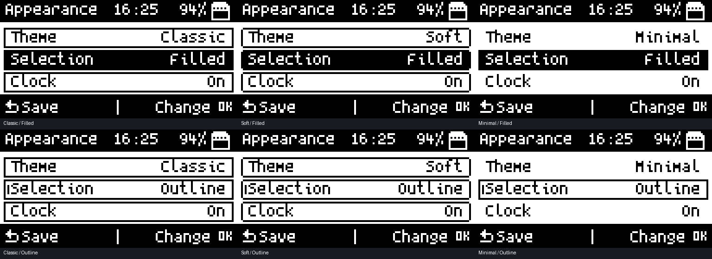

# Appearance · revision 5

Open **System → Appearance**. Up/Down selects a preference; center OK changes it. Left/Right cycles values. Back saves and returns. The screen previews changes immediately.

| Preference | Choices |
|---|---|
| Theme | Classic frames, Soft rounded frames, Minimal unselected rows |
| Selection | Filled highlight, outlined highlight with a side marker, or Underline (revision 13) |
| Clock | Show or hide the home/shared runtime header clock |
| Time format | 24-hour or 12-hour; runtime headers include a/p |
| Battery | Show or hide percentage in home/shared runtime headers |
| Animation | Animate the home logo or keep it still |
| Menu wrap | Wrap at the ends of shared menus, or stop there |
| Reset theme | Confirm before restoring appearance defaults |

Default: Soft, filled selection, 24-hour clock, battery visible, animation and wrapping enabled. Reset changes appearance preferences only, not remotes or radio configuration. The reset is saved when leaving Appearance.

Preview uses the firmware's actual drawing primitives, fonts, and bitmap assets on a desktop framebuffer. It is not a photograph or a physical-device test.

## Coverage

Shared main/submenus, shared status/detail panels, common informational and choice dialogs, LCD settings selections, and My Remotes list selections use the new foundation. Text drawn through the shared bounded-label helper truncates with an ellipsis instead of overflowing adjacent controls. Informational dialogs use Back/OK; choice dialogs use arrows to select, OK to confirm, and Back to cancel. Directional legends remain for genuinely directional actions.

The existing portrait remote grid, capture/replay code, and Skip workflow are retained. Games, keyboards, file browsing, and bespoke application screens have their own layouts; this revision does not claim to restyle every one. Menu wrap applies to the shared menu engine and Appearance, not all independent app lists.

## Saving and recovering preferences

Appearance uses `System/appearance.cfg` on the SD card. Its small versioned format is independent of upstream's settings and the fixed firmware configuration structure. Save writes and closes a temporary file before replacing the previous settings, retaining `appearance.cfg.bak`. Failed writes/replacements show an error; replacement failure attempts to restore the prior file. At startup a missing main file falls back to the backup. This reduces exposure to interrupted writes, but is not a guarantee against SD corruption or power loss.

For a PC backup, copy `System/appearance.cfg` and your existing `System/settings.cfg`. Restore them with the device powered off or its SD card handed to USB, then reboot. New firmware defaults apply to missing or unsupported appearance fields. The firmware does not automatically update itself.

## Continuing the interface work

1. **Foundation (revision 5):** shared styles, predictable common dialogs, bounded labels, live preferences, persistence, and native checks. Owner confirmed boot and Appearance changes/saving on the physical M1. Other app screens and power-cycle persistence still need separate hardware checks.
2. **Application migration:** audit each bespoke screen and migrate menus, progress, errors, popups, and action legends to shared components. Preserve radio and remote behavior; validate each affected app on hardware.
3. **Personal workspace:** favorites/recent items, optional home layouts, shortcuts, splash selection, larger-text layouts, first-run setup, and richer backup/restore controls. These are planned, not implemented in revision 5.

## Upstream updates

Use the repository's existing `tools/remote_edition/sync_upstream.py` review-branch workflow. Keep UI policy in `m1_ui_theme.h`, rendering in the shared display layer, and appearance persistence separate from upstream settings. Review conflicts rather than dropping either side, run native tests and a firmware build, then check affected screens on the M1 before installing/publishing an update. Upstream stock firmware binaries do not contain edition features; builds must come from merged edition source.

Original firmware credit belongs to [dagnazty and T-1000 contributors](https://github.com/dagnazty/M1_T-1000).
