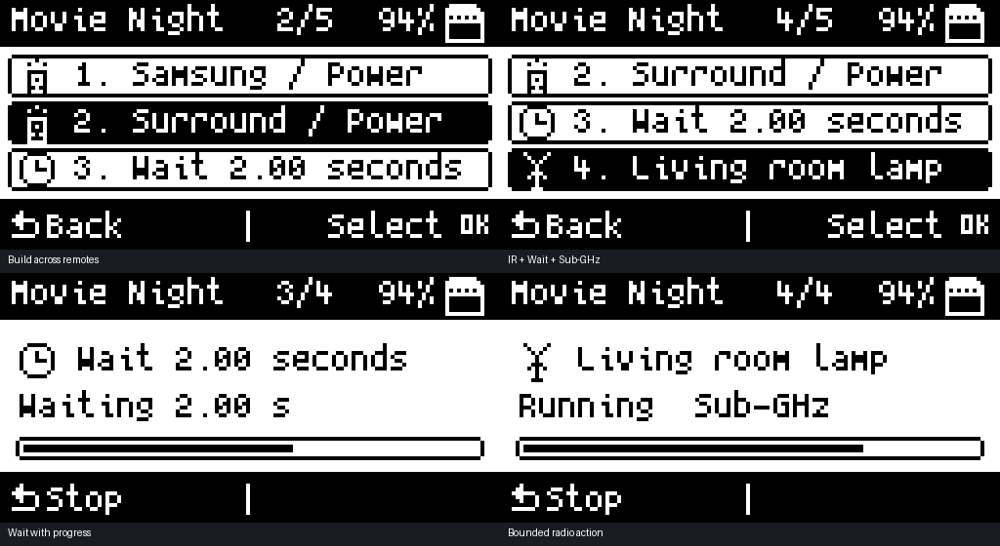

# Remote automations · revision 7

**Infrared → Automations** builds named sequences across saved IR remotes and native Sub-GHz recordings. Each sequence runs once when you choose Run and confirm; it does not run on boot or on a schedule.

The preview is rendered from the actual firmware list/progress functions, fonts, and icons. It is not a device photograph. Revision 6 boot and menu presence were confirmed on the M1. Revision 7 fixes direct selection without first opening a remote elsewhere. Build and native tests passed; revision 7 installation and physical IR/RF validation are pending.

## Build a sequence

1. Choose **+ New automation** and enter a name, such as **Movie Night**.
2. Choose **+ Add action → IR remote button**, browse the IR folders, and choose a specific button from a saved remote. Repeat for other devices/remotes.
3. Add **Wait / delay** steps for equipment that needs time to start. Choices range from 0.10 to 60 seconds.
4. Add a **Sub-GHz recording** from `SUBGHZ` when needed.
5. Select any existing step to move it earlier/later, replace it, rename its label, change a Wait duration, duplicate it, or confirm deletion. **Duplicate action** inserts a separate copy immediately after the selected step. Repeated commands are retained, including Power → Wait → Power.
6. Press **Back** in the editor to save. Open the automation's menu and choose **Run sequence**, then confirm. Keep the M1 aimed toward your IR devices.

For example: TV Power → Wait 2 seconds → Surround Power → a saved Sub-GHz lamp/socket action. Prefer discrete On commands when a remote provides them: a Power toggle changes the device's current state.

The automation menu also supports **Rename**, **Duplicate**, and confirmed **Delete**. Deleting a chain leaves its source remotes/recordings intact. Up/Down moves, center OK selects, and Back returns; during execution Back stops. Completed actions remain in effect when you stop.

## Supported sources and limits

| Item | Behavior |
|---|---|
| IR | One selected supported parsed/raw button from a saved `.ir` file, through the existing replay engine. Up to 64 parsed entries per source. |
| Sub-GHz | Saved native M1 `.sgh` NOISE recordings using OOK, ASK, or FSK. Region restrictions and configured transmit power remain in effect. Each action uses one native replay burst, including its normal internal repetitions; it never enables continuous Repeat mode. |
| Wait | 100 ms through 60 seconds, selectable on device. A 250 ms settling gap also follows each transmission. |
| Size | 16 actions per chain; 32 chains in the on-device library. File pickers have paging and folder navigation. |
| Source protection | The source file's contents are fingerprinted at selection. Every source is checked before any action is sent, then checked again before its step. Changed/missing sources stop the chain; replace that step to bind the updated file. IR button names are checked too. |
| Failure | Stops at a failed or timed-out action. Remaining actions are skipped. Completion means the sequence was sent; device state is not sensed or confirmed. |

Source files must fit within 256 KiB for fingerprinting. Native RF captures must have CRLF line endings, valid 16-bit durations, an even number of timing entries, and no more than five seconds of recorded timings. Long native data lines are supported. A radio action times out after 30 seconds, and IR after five seconds. Unsupported recordings are rejected rather than truncated for replay.

Flipper `.sub` KEY/RAW imports are **not selected directly by the chain picker**. Use a working native M1 recording for an RF step. IR automation retains the existing replay engine's protocol and raw-buffer limits.

## Philips Hue

Direct Hue control is not implemented. Hue lights use Zigbee/Bluetooth; Hue Bridge integration requires a separate paired network/API connection. The ESP32-C6's presence alone does not supply that integration. See [Philips Hue's connection overview](https://www.philips-hue.com/en-us/explore-hue/how-it-works.) and [Hue's developer guide](https://developers.meethue.com/develop/get-started-2/).

An RF-controlled lamp/socket action in the example is an ordinary compatible Sub-GHz device, not a claim of direct Hue support.

## Files, backups, and upstream maintenance

Chains live under `IR/Automations/chain_NNN.chain`. The text format starts with `Filetype: M1 Automation` and `Version: 1`, then stores the display name and ordered step references. Source `.ir`/`.sgh` files are read only. Preferences are independent of the fixed upstream firmware config structure.

Saving writes/closes a temporary file before replacement and retains the previous chain as `.bak`. Failed replacement attempts to restore the prior file. If a chain is missing or invalid after an interrupted write, restore its `.bak` with a PC/card reader. Back up the entire `IR/Automations` folder along with its referenced IR/Sub-GHz sources; source paths must remain the same after restoration.

The parser/editor live in separate automation modules. Small adapters reuse the existing IR and native Sub-GHz replay engines. Continue using the repository's review-branch upstream merge helper, then run native checks, build firmware, and check affected actions on the M1. Original T-1000 credit remains with [dagnazty and contributors](https://github.com/dagnazty/M1_T-1000).

## Validation

- Actual persistence code: 16-step mixed roundtrip, move/delete, replacement-failure rollback, malformed versions/counts/delays/paths, changed-file detection, and long/invalid RF timing streams.
- Actual executor: ordered IR/Wait/RF dispatch, full preflight, confirmation cancellation, mid-action cancellation, and fail-fast behavior.
- Actual transport adapters against simulated hardware/queues: selected IR button only, one bounded RF burst, cancellation, allocation/start/parser failures, timeout cleanup, and RF configuration restoration.
- Actual list/progress drawing functions: bounds checks for every 0–16-step chain and 1–65-choice list; native-font desktop previews.
- Existing IR parser, remote builder, navigation, Skip, theme, and splash regression checks remain included.

Physical transmission and end-device response still need M1 testing; host tests and a build do not certify those behaviors.

Regression coverage includes the actual parser and automation picker API from a cold start, switching between large and small remotes, clearing failed loads, Epson NECext Power selection, and repeated-command save/reload/playback.
