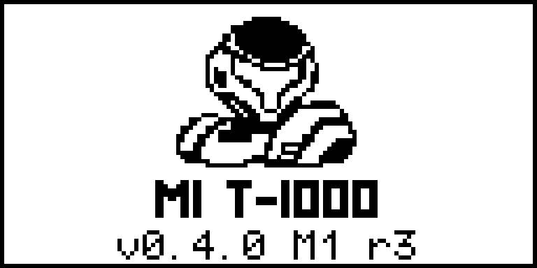

# Avatar splash — revision 3

The startup/home artwork is adapted from [Dread7us's GitHub avatar](https://avatars.githubusercontent.com/u/1151957?v=4), retrieved on 2026-11-03. The original gold-armored character is simplified to a recognizable helmet and upper-armor emblem for the M1's monochrome screen.

This preview comes from the **actual `startup_info_screen_display()` implementation**, rendered with the repository's real u8g2 bitmap and fonts on a host. Hardware I/O is stubbed. It is enlarged with nearest-neighbor pixels; it is not a photograph of the physical M1.

## Layout

- 128×64 display, existing outer frame retained.
- 48×38 emblem, centered at x=40, y=3.
- Original M1 T-1000 title at baseline y=52.
- Version or operation-status message at baseline y=62.
- Removed the old y=44 divider, which passed through the title glyphs.

## Asset files

- `avatar-emblem-source.png`: selected source artwork.
- `avatar-emblem-48x38.png`: display-sized monochrome asset.
- `m1_csrc/m1_splash_art.h`: 228-byte XBM data consumed by firmware.
- `tools/remote_edition/encode_splash.py`: deterministic asset encoding (requires Pillow).

## Asset specification

The current avatar is the edit reference for this design specification:

> Use case: style-transfer. Edit target: the supplied current GitHub avatar. Make a production-ready ultra-simple monochrome pixel-art firmware emblem based faithfully on this specific gold-armored character: helmet with its distinctive angular T/Y-shaped visor and a small amount of upper shoulder armor, preserving the three-quarter orientation. This is for a tiny 128x64 monochrome LCD, emblem will occupy only 48x38 pixels. Crop away the gun, lower body, and scene. Pure white background, pure black bold armor contour shapes and a white visor opening outlined in black, large clean readable silhouette, very few chunky pixel details. Use a logical 48 by 38 pixel grid, enlarged evenly with sharp square pixels and no antialiasing. Center the emblem, modest white padding, no text, no border, no gradients, no gray, no dithering, no decorative lines. Recognition at actual tiny size matters most.

The selected source is thresholded, fitted into a 46×36 interior with a one-pixel margin, and encoded as row-major, least-significant-bit-first XBM bytes. The encoder changes the format and scale for the LCD; the selected design remains the source artwork.
