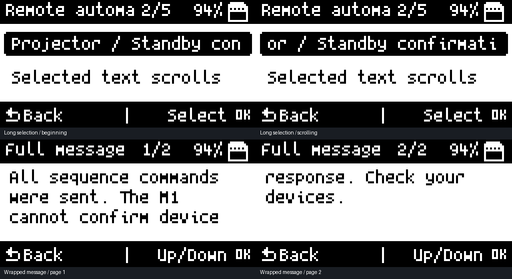

# Readable text and IR recovery · revision 8

Preview uses the firmware's actual scrolling/wrapping code and fonts on a desktop framebuffer. Physical readability and IR output still need review on the M1.

## Reading long text

- **Menus and automation selections:** leave a long item selected. It pauses, scrolls character by character, pauses at the end, and returns. Shared runtime headers scroll when their screen refreshes.
- **My Remotes:** manager/button lists refresh their long labels rather than requiring another button press.
- **Common messages:** text wraps into three readable lines per page. Use **Up/Down** to change pages, **OK** to acknowledge, or **Back** to return.
- **Confirmation dialogs:** **Left/Right** selects a choice, **OK** confirms, and **Back** cancels. Up/Down changes pages for a long message; on a one-page dialog it can also select choices.
- **Older app screens:** open **System → Read screen text** after encountering clipped text. The drawing layer captures the original overflowing string, and the viewer wraps it across pages. OK advances to the next saved entry; Back leaves the viewer. The eight most recently captured distinct overflowing strings (up to 512 characters each) stay in RAM until reboot; they are not written to the SD card.

The application-wide drawing hook covers direct `u8g2_DrawStr` calls without putting a background task in charge of drawing over radio or capture screens. Shared bounded labels also record their original contents before fitting them. Independent legacy screens are not all converted to animated layouts: the text viewer supplies full-text access without changing their event/timing behavior. Strings already shortened before drawing cannot be reconstructed by the drawing hook.

The [text-call inventory](text-audit.json) records direct text drawing across application modules. It is a static review inventory, not certification that every third-party app, font, language, and screen fits perfectly.

## IR corrections

Revision 8 addresses concrete defects found while investigating intermittent IR and a mixed-device sequence:

| Correction | Result |
|---|---|
| Fully initialized PWM/master configuration | Polarity, idle state, and master fields no longer depend on uninitialized stack contents. |
| Fresh peripheral boundary before each send | TIM1/TIM16 are reset, HAL handles and sample pointers/counters are cleared, and pending IR interrupts/delay state are cleared before initialization. |
| Bounded interrupt prefetch | A final timing entry no longer causes a read of `buffer[length]`; one-sample raw sends also initialize the pipeline correctly. |
| Complete parsed commands | Shared replay/automation completion follows required protocol frames and delays instead of treating the first frame interrupt as the whole command. |
| Correct TX protocol | Frame post-processing uses the transmit protocol rather than the last received protocol. |
| Delay lifecycle | Each protocol delay has one timer, a waiting state, and cleanup. Delay values retain their 16-bit width. |
| Kaseikyo field conversion | Flipper manufacturer, genre, device-id, and command fields are translated to/from IRMP instead of truncating the address to 16 bits. The Denon wire-byte regression vector is covered. |
| Full raw timing streams | Long `data:` lines are streamed across buffer/token boundaries up to 512 samples. Reading and writing no longer silently lose the rest of a fan/learned signal at a text-buffer boundary. |

The automation completion message reports steps processed. As before, it does not measure or confirm the resulting device state. A sequence is not automatically retried, since retransmitting Power toggles could reverse an action that already worked.

Existing `.chain` files remain compatible. Original remote files and saved sequences are not rewritten by this firmware update. A local diagnostic copy was used for investigation; no user-specific sequence is bundled in the public repository.

## Evidence and remaining checks

Native checks exercise the actual interrupt TX branch for 1–512 entries, 1,000 consecutive simulated multi-frame commands, 1,000 alternating-frequency carrier configurations, Denon/Kaseikyo wire bytes and all id/genre combinations, full 512-sample raw read/write at 16 token/space boundary alignments, long-text scrolling bounds, lossless page wrapping, and all existing remote/automation regressions. Firmware builds locally with CRC packaging checks.

Those tests verify the identified code paths against simulated peripherals and queues. They do not prove that an intermittent hardware fault can never recur. After installation, use the Flipper as an IR receiver to check consecutive parsed/raw transmissions and the saved mixed-device sequence, including after leaving/reopening IR and after standby. Device responses and extended hardware endurance remain separate checks.

Original firmware credit remains with [dagnazty and T-1000 contributors](https://github.com/dagnazty/M1_T-1000). The UI text hook is a small edition integration in the existing u8g2 drawing entry point; preserve the upstream library license and review that hook when merging library updates.
